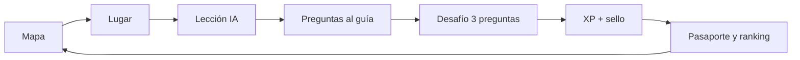

# 🧭 SucreGo

> **Tu ciudad. Tu historia. Tu aventura.**

SucreGo es una PWA _mobile-first_ que convierte las calles de Sucre en una aventura de aprendizaje: mapa de lugares patrimoniales, lecciones conversacionales con IA basadas en fuentes verificadas, desafíos cortos y progresión por XP.

**Equipo:** VibeCoders · **Evento:** Hackathon Regional Sucre 2026 · **Tiempo:** 10 horas

---

## 🎯 Problema y propuesta

Los jóvenes de Sucre reconocen muchos espacios patrimoniales, pero no necesariamente conocen su historia ni su importancia. **Hipótesis:** si explorar el patrimonio es una actividad breve, interactiva y personalizada, habrá más razones para visitar los lugares y aprender de ellos.

Inspirada en la mecánica de exploración de Pokémon GO y la constancia de Duolingo, con identidad cultural propia.

## 🔁 Flujo principal (MVP)



**Reglas del juego:** 2 de 3 respuestas correctas aprueban · 100 XP solo la primera vez por misión · Niveles: Explorador (0–99), Investigador (100–199), Cronista (200+).

## ✅ Alcance

| Prioridad | Funcionalidad                                                                                                |
| --------- | ------------------------------------------------------------------------------------------------------------ |
| P0        | Mapa móvil (3 lugares) · Detalle · Guía IA con fuentes · Desafío · XP y niveles · Perfil/Pasaporte · Ranking |
| P1        | QR de demostración · PWA instalable                                                                          |
| P2        | Amigos, rutas, AR, eventos (solo visión futura)                                                              |

Ninguna funcionalidad P1 empieza antes de que el flujo P0 esté integrado y probado.

## 🧱 Stack

| Capa     | Tecnología                                               |
| -------- | -------------------------------------------------------- |
| Frontend | React + TypeScript + Vite · React Router · Tailwind CSS  |
| Mapa     | Leaflet / React-Leaflet + OpenStreetMap                  |
| Backend  | Express + TypeScript (API REST)                          |
| Datos    | Supabase PostgreSQL (+ Auth)                             |
| IA       | LLM + embeddings, recuperación semántica (RAG) con citas |
| QA       | Vitest + smoke tests del flujo móvil                     |
| Deploy   | Vercel (web) + Render (API), con demo local de respaldo  |

## 📁 Estructura del repositorio

```text
sucrego/
├── apps/
│   ├── web/          # Frontend React + Vite
│   └── api/          # API Express + TypeScript
├── docs/
│   ├── CHECKLIST.md        # Progreso del equipo
│   ├── api-contract.md     # Contratos REST
│   ├── ai-disclosure.md    # Uso de IA (declaración oficial)
│   └── sources.md          # Fuentes históricas registradas
├── .github/
│   └── copilot-instructions.md
├── .env.example
└── README.md
```

> La estructura se irá materializando en `chore/project-bootstrap`.

## 🚀 Cómo ejecutar

Requiere Node.js y npm. Desde la raíz del repositorio:

```bash
npm install
```

Inicia cada workspace en una terminal distinta:

```bash
# Terminal 1: API (http://localhost:3001)
npm run dev --workspace apps/api
```

```bash
# Terminal 2: frontend (Vite muestra la URL local, normalmente http://localhost:5173)
npm run dev --workspace apps/web
```

Comprueba que la API está disponible:

```bash
curl http://localhost:3001/health
```

La respuesta esperada es `{"status":"ok"}`. Sin `VITE_API_BASE_URL`, el frontend abre
el modo demo con datos identificados como muestra. Los sellos de práctica duran solo
durante la sesión de la página y la demo no concede XP.

Para validar cambios desde la raíz:

```bash
npm run lint
npm test
npm run build
npm run format:check
```

## 🔐 Variables de entorno

Para conectar el frontend a una API que implemente [el contrato](docs/api-contract.md),
define `VITE_API_BASE_URL` (sin el sufijo `/api`), `VITE_SUPABASE_URL` y
`VITE_SUPABASE_PUBLISHABLE_KEY` en el entorno de Vite o en el `.env` de la raíz.
`VITE_SUPABASE_ANON_KEY` admite la clave pública anterior.

### Preparar el despliegue

1. **Vercel.** Importa el repositorio con `apps/web` como directorio raíz, el preset
   Vite y acceso a los archivos del monorepo fuera de ese directorio. La salida es
   `dist` y [la configuración](apps/web/vercel.json) habilita los enlaces directos.
   Un Preview con `VITE_API_BASE_URL` vacía sirve la demo.
2. **Supabase.** Identifica el proyecto del equipo y comprueba si ya tiene aplicada
   [la migración inicial](supabase/migrations/0001_init.sql). Habilita el acceso
   anónimo en Auth y usa la clave pública en Vercel. El
   [seed actual](supabase/seed.sql) contiene textos y preguntas provisionales.
3. **Render.** Cuando se integren los endpoints, configura el servicio desde la
   raíz del repo con `npm ci && npm run build --workspace apps/api` y
   `npm run start --workspace apps/api`. Si el servidor sigue leyendo `API_PORT`,
   configúralo con el mismo valor que el puerto del servicio. Usa `/health` para
   el chequeo de salud y autoriza el origen del frontend mediante CORS.
   Configura las credenciales de Supabase y Gemini como variables privadas del servicio.
4. **Integración.** Tras verificar `/health` y `/api/places` en Render, define
   `VITE_API_BASE_URL` con ese origen y vuelve a desplegar Vercel. En el Preview,
   abre `/explore` directamente y recorre ficha, guía, quiz, pasaporte y ranking.
   Repite una misión aprobada y verifica que el servidor responda con
   `xpAwarded: 0` en el segundo envío.

Consulta [`.env.example`](.env.example). Las credenciales privilegiadas y las
claves del modelo viven solo en el backend.

## 🌿 Estrategia Git (GitFlow simplificado)

| Rama                                             | Propósito                                                                                        |
| ------------------------------------------------ | ------------------------------------------------------------------------------------------------ |
| `main`                                           | Siempre estable y demostrable. Solo recibe merges desde `develop` en hitos. Aquí van los _tags_. |
| `develop`                                        | Rama de integración. Todas las PR apuntan aquí.                                                  |
| `feat/*`, `fix/*`, `chore/*`, `test/*`, `docs/*` | Una rama por funcionalidad, creada desde `develop`.                                              |

Ramas planificadas: `chore/project-bootstrap` · `feat/mobile-map` · `feat/place-details` · `feat/rag-guide` · `feat/quiz-and-xp` · `feat/profile-leaderboard` · `test/mvp-validation` · `docs/pitch-evidence`

**Commits:** [Conventional Commits](https://www.conventionalcommits.org/) — `feat:`, `fix:`, `chore:`, `docs:`, `test:`, `refactor:`.

**Definition of Done:** compila · respeta el contrato · tiene prueba relevante · maneja errores y estados vacíos · funciona en móvil · sin secretos · PR revisada · decisiones documentadas.

## 🤖 IA responsable

- El guía **solo** responde con información respaldada por fuentes revisadas, cita y se **abstiene** cuando no hay evidencia.
- El puntaje y el XP los calcula el **servidor**, nunca el chat.
- Ubicación solo para mostrar cercanía; no se almacenan coordenadas por defecto.
- Ranking con alias públicos, sin nombres reales.
- Uso de herramientas de IA registrado en [`docs/ai-disclosure.md`](docs/ai-disclosure.md).

## 🗺️ Atribución

Mapa © colaboradores de [OpenStreetMap](https://www.openstreetmap.org/copyright). Imágenes: solo con autorización verificada.

## 👥 Equipo

| Frente            | Responsable   |
| ----------------- | ------------- |
| Technical Lead    | Roi           |
| UX/UI             | _por asignar_ |
| Frontend          | _por asignar_ |
| Backend           | _por asignar_ |
| IA y contenido    | _por asignar_ |
| QA / presentación | _por asignar_ |

## 📋 Progreso

Ver [`docs/CHECKLIST.md`](docs/CHECKLIST.md).
