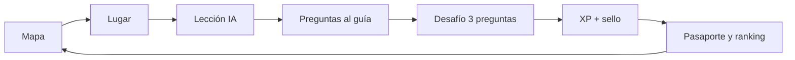

# 🧭 SucreGo

> **Tu ciudad. Tu historia. Tu aventura.**

SucreGo es una PWA *mobile-first* que convierte las calles de Sucre en una aventura de aprendizaje: mapa de lugares patrimoniales, lecciones conversacionales con IA basadas en fuentes verificadas, desafíos cortos y progresión por XP.

**Equipo:** VibeCoders · **Evento:** Hackathon Regional Sucre 2026 · **Tiempo:** 10 horas

---

## 🎯 Problema y propuesta

Los jóvenes de Sucre reconocen muchos espacios patrimoniales, pero no necesariamente conocen su historia ni su importancia. **Hipótesis:** si explorar el patrimonio es una actividad breve, interactiva y personalizada, habrá más razones para visitar los lugares y aprender de ellos.

Inspirada en la mecánica de exploración de Pokémon GO y la constancia de Duolingo, con identidad cultural propia.

## 🔁 Flujo principal (MVP)



**Reglas del juego:** 2 de 3 respuestas correctas aprueban · 100 XP solo la primera vez por misión · Niveles: Explorador (0–99), Investigador (100–199), Cronista (200+).

## ✅ Alcance

| Prioridad | Funcionalidad |
| - | - |
| P0 | Mapa móvil (3 lugares) · Detalle · Guía IA con fuentes · Desafío · XP y niveles · Perfil/Pasaporte · Ranking |
| P1 | QR de demostración · PWA instalable |
| P2 | Amigos, rutas, AR, eventos (solo visión futura) |

Ninguna funcionalidad P1 empieza antes de que el flujo P0 esté integrado y probado.

## 🧱 Stack

| Capa | Tecnología |
| - | - |
| Frontend | React + TypeScript + Vite · React Router · Tailwind CSS |
| Mapa | Leaflet / React-Leaflet + OpenStreetMap |
| Backend | Express + TypeScript (API REST) |
| Datos | Supabase PostgreSQL (+ Auth) |
| IA | LLM + embeddings, recuperación semántica (RAG) con citas |
| QA | Vitest + smoke tests del flujo móvil |
| Deploy | Vercel (web) + Render (API), con demo local de respaldo |

## 📁 Estructura del repositorio

```text
sucrego/
├── apps/
│   ├── web/          # Frontend React + Vite
│   └── api/          # API Express + TypeScript
├── docs/
│   ├── CHECKLIST.md        # Progreso del equipo
│   ├── api-contract.md     # Contratos REST
│   ├── ai-disclosure.md    # Uso de IA (declaración oficial)
│   └── sources.md          # Fuentes históricas registradas
├── .github/
│   └── copilot-instructions.md
├── .env.example
└── README.md
```

> La estructura se irá materializando en `chore/project-bootstrap`.

## 🚀 Cómo ejecutar

> 🚧 Se completará al cerrar `chore/project-bootstrap`.

```bash
# 1. Instalar dependencias
# 2. Copiar variables de entorno:  cp .env.example .env
# 3. Levantar API y web en desarrollo
```

## 🔐 Variables de entorno

Ver `.env.example`. **Nunca** se suben claves reales al repositorio. Las claves del modelo y credenciales privilegiadas viven solo en el backend.

## 🌿 Estrategia Git (GitFlow simplificado)

| Rama | Propósito |
| - | - |
| `main` | Siempre estable y demostrable. Solo recibe merges desde `develop` en hitos. Aquí van los *tags*. |
| `develop` | Rama de integración. Todas las PR apuntan aquí. |
| `feat/*`, `fix/*`, `chore/*`, `test/*`, `docs/*` | Una rama por funcionalidad, creada desde `develop`. |

Ramas planificadas: `chore/project-bootstrap` · `feat/mobile-map` · `feat/place-details` · `feat/rag-guide` · `feat/quiz-and-xp` · `feat/profile-leaderboard` · `test/mvp-validation` · `docs/pitch-evidence`

**Commits:** [Conventional Commits](https://www.conventionalcommits.org/) — `feat:`, `fix:`, `chore:`, `docs:`, `test:`, `refactor:`.

**Definition of Done:** compila · respeta el contrato · tiene prueba relevante · maneja errores y estados vacíos · funciona en móvil · sin secretos · PR revisada · decisiones documentadas.

## 🤖 IA responsable

- El guía **solo** responde con información respaldada por fuentes revisadas, cita y se **abstiene** cuando no hay evidencia.
- El puntaje y el XP los calcula el **servidor**, nunca el chat.
- Ubicación solo para mostrar cercanía; no se almacenan coordenadas por defecto.
- Ranking con alias públicos, sin nombres reales.
- Uso de herramientas de IA registrado en [`docs/ai-disclosure.md`](docs/ai-disclosure.md).

## 🗺️ Atribución

Mapa © colaboradores de [OpenStreetMap](https://www.openstreetmap.org/copyright). Imágenes: solo con autorización verificada.

## 👥 Equipo

| Frente | Responsable |
| - | - |
| Technical Lead | Roi |
| UX/UI | _por asignar_ |
| Frontend | _por asignar_ |
| Backend | _por asignar_ |
| IA y contenido | _por asignar_ |
| QA / presentación | _por asignar_ |

## 📋 Progreso

Ver [`docs/CHECKLIST.md`](docs/CHECKLIST.md).
